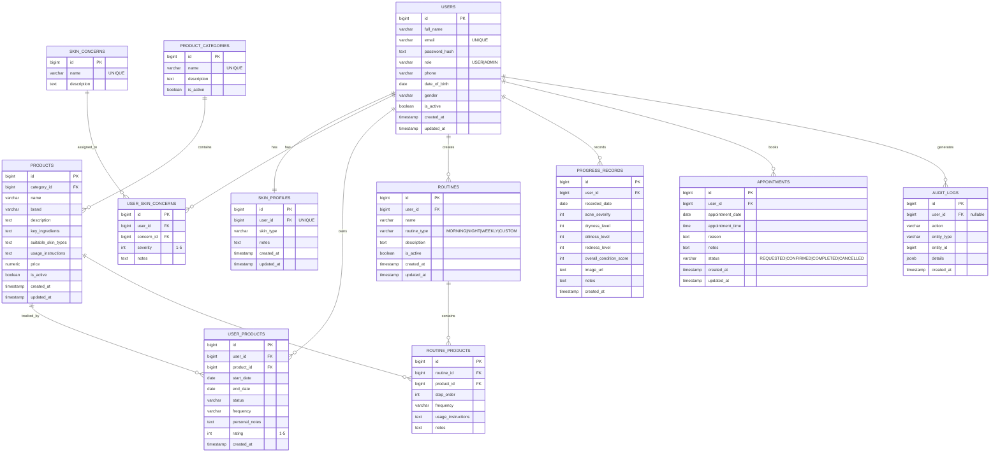

# ER Diagram

The full SCMS database can be represented as follows. Mermaid renders this
nicely on GitHub.

## Relationship summary

| Relationship | Cardinality | Notes |
|--------------|-------------|-------|
| `users → skin_profiles` | 1:1 | A user has at most one profile |
| `users ↔ skin_concerns` | M:N | Via `user_skin_concerns`, includes severity |
| `product_categories → products` | 1:N | A category has many products |
| `users ↔ products` | M:N | Via `user_products` (personal cabinet) |
| `users → routines` | 1:N | A user creates many routines |
| `routines ↔ products` | M:N | Via `routine_products` (with `step_order`) |
| `users → progress_records` | 1:N | Self-reported progress |
| `users → appointments` | 1:N | With admin-managed status |
| `users → audit_logs` | 1:N | Action trail; nullable for system events |